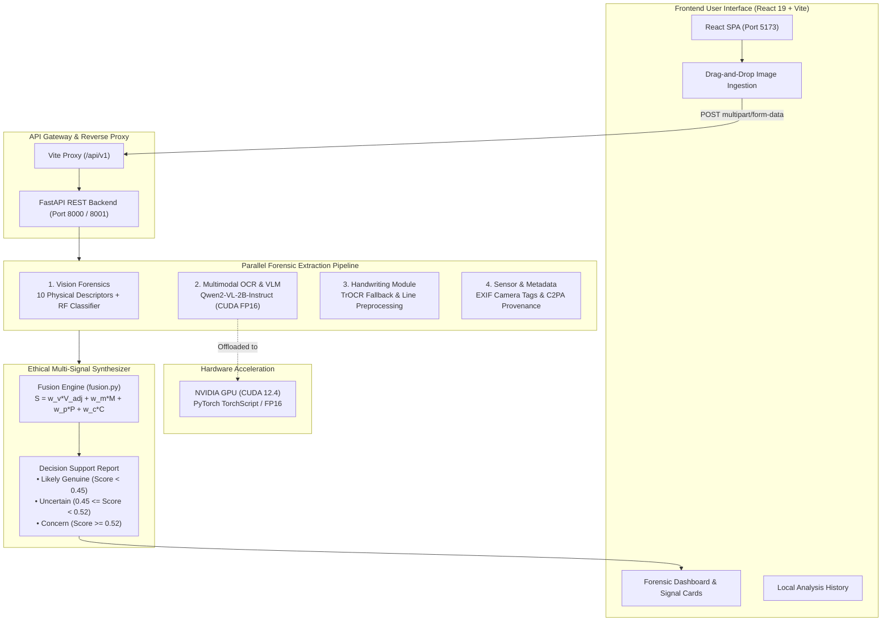

# 🎓 EduVerify AI — Academic Integrity & Handwriting Forensics Platform

[](https://fastapi.tiangolo.com/)
[](https://react.dev/)
[](https://vitejs.dev/)
[](https://pytorch.org/)
[](https://huggingface.co/Qwen/Qwen2-VL-2B-Instruct)
[](https://scikit-learn.org/)
[](https://opencv.org/)
[](LICENSE)

**EduVerify AI** is an explainable, multimodal forensic analysis platform designed for educators, teaching assistants, and academic institutions. It analyzes handwritten assignments, exam booklets, laboratory reports, and digital document submissions to detect AI-synthesized handwriting (e.g., ChatGPT DALL-E 3, Handify AI, synthetic font plotters), digital manipulation, and tampering while providing verbatim handwriting transcription and ethical decision support.

---

## 📌 Table of Contents
- [What is EduVerify AI?](#-what-is-eduverify-ai)
- [What is it For? (Core Purpose)](#-what-is-it-for-core-purpose)
- [Core Ethical Framework](#-core-ethical-framework)
- [Technologies & Stack](#-technologies--stack)
- [System Architecture](#-system-architecture)
- [Forensic Detection Modules](#-forensic-detection-modules)
- [Multi-Signal Fusion Formula](#-multi-signal-fusion-formula)
- [Verbatim Image Preservation & Orientation](#-verbatim-image-preservation--orientation)
- [Project Directory Structure](#-project-directory-structure)
- [Quick Start Guide](#-quick-start-guide)
- [Automated Scripts](#-automated-scripts)
- [Testing & Quality Assurance](#-testing--quality-assurance)
- [API Reference](#-api-reference)
- [License](#-license)

---

## 🔍 What is EduVerify AI?

With generative AI models (such as OpenAI's DALL-E 3, Midjourney, and synthetic handwriting tools like Handify AI) capable of generating photorealistic "handwritten" essays on lined paper with artificial deskew, paper grain, and pencil smudges, traditional OCR and simple text plagiarism checks are no longer sufficient.

**EduVerify AI** closes this verification gap by providing a multi-layered, forensic verification pipeline that examines:
1. **Physical Surface Optics & Frequency Domain:** Fourier transform (FFT) spectral roll-off, sensor noise variance, illumination gradients, and stroke tortuosity.
2. **Deep Learning Vision Classifier:** Trained Random Forest model analyzing 10 extracted physical and statistical features.
3. **Multimodal VLM Forensics & OCR:** `Qwen2-VL-2B-Instruct` inspecting stroke pressure dynamics, baseline wavering, organic glyph imperfections, and transcribing text verbatim.
4. **Hardware Sensor & EXIF Signatures:** Camera make/model verification, editing software detection (Photoshop, Canva, Procreate), and C2PA cryptographic provenance.

---

## 🎯 What is it For? (Core Purpose)

- **Combat AI-Generated Handwriting:** Identify synthetic essays created by generative diffusion models or digital handwriting generators masquerading as authentic physical student work.
- **Transcribe Student Submissions:** Accurate GPU-accelerated handwritten text extraction (OCR) capable of deciphering cursive, slanted, and faint handwriting.
- **Protect Authentic Students:** Eliminate false accusations. Students writing with fountain pens, ballpoint pens, under flat scanner beds, or in low-light environments are actively shielded through quality-factor adjustments and multi-signal cross-validation.
- **Actionable Decision Support:** Provide educators with a clear, color-coded dashboard explaining *why* a document received a given classification, with structured recommendations for student dialogue.

---

## ⚖️ Core Ethical Framework

> [!IMPORTANT]
> **EduVerify AI is an Educator Decision-Support Tool — NOT an Automated Accuser.**
> Automated detectors can produce false positives that unfairly harm real students. EduVerify AI:
> 1. **Never accuses:** Verdicts are labeled as `Likely Genuine Student Work`, `Uncertain / Additional Context Recommended`, or `Concern / Possibly AI-Generated or Edited`.
> 2. **Never outputs absolute 0% or 100% probabilities:** The score is reported as `ai_generation_signal_score` (an uncalibrated triangulation metric).
> 3. **Mandatory Ethical Disclaimer:** Included on every generated report and frontend view:
>    *“EduVerify AI provides decision support only. Automated predictions should never be used as sole proof of misconduct.”*

---

## 🛠️ Technologies & Stack

### Backend
- **FastAPI**: Modern, asynchronous high-performance Python web API with automated OpenAPI / Swagger documentation.
- **PyTorch & CUDA 12.4**: Hardware-accelerated neural network inference on dedicated NVIDIA GPUs (e.g., RTX 3050).
- **Qwen2-VL-2B-Instruct**: Multimodal Vision-Language Model (VLM) for fine-grained forensic analysis and verbatim document transcription.
- **OpenCV & NumPy**: Micro-texture analysis, 2D FFT spectral transforms, Otsu binarization, Sobel stroke gradients, and contour analysis.
- **Scikit-Learn**: Random Forest ensemble classifier trained on 10 extracted physical forensic features.
- **ExifRead & PIL (Pillow)**: Camera metadata extraction, color profile validation, and format sniffing.
- **Pytest & AnyIO**: Comprehensive test suite with 123 tests covering unit, integration, and adversarial edge cases.

### Frontend
- **React 19**: Modern component-based user interface.
- **Vite 6**: Next-generation lightning-fast frontend tooling and asset bundling.
- **Tailwind CSS & Lucide Icons**: Clean, accessible, responsive design system.
- **Framer Motion**: Smooth animations for forensic score gauges and signal cards.

---

## 🏛️ System Architecture



---

## 🔬 Forensic Detection Modules

### 1. Vision Forensics & ML Classifier (`vision.py`)
Extracts 10 statistical, frequency, and optical features from document images:
- **Laplacian Variance:** Measures micro-edge sharpness and blur.
- **Dark Stroke Fraction:** Fraction of pixels belonging to ink strokes.
- **Edge Gradient Sharpness:** Sobel operator gradient magnitudes.
- **2D FFT Spectral Ratio:** High-to-low frequency spectral energy roll-off (diffusion models exhibit distinct frequency-domain roll-off anomalies).
- **Paper Texture Noise ($\sigma$):** Natural sensor noise vs. synthetic sterile smoothing.
- **Illumination Spatial CV:** Coefficient of variation of background brightness (real photos exhibit natural lighting fall-off; generative models often render uniform flat illumination).
- **Stroke Thickness Uniformity CV:** Variance of stroke widths across characters.
- **Local Binary Pattern (LBP) Entropy:** Micro-texture descriptor of the paper fibers.
- **GLCM Contrast:** Gray-Level Co-occurrence Matrix texture contrast.
- **Contour Tortuosity:** Organic curvature of ink paths.

A **Random Forest Classifier** (`backend/models/visual_detector.joblib`) classifies these 10 features with 80% cross-validated accuracy, 82% ROC-AUC, and low false-positive rates.

### 2. Multimodal OCR & VLM Forensics (`ocr.py`)
- Powered by `Qwen/Qwen2-VL-2B-Instruct` in FP16 on CUDA.
- **Transcription:** Transcribes handwritten text verbatim line-by-line without artificial line slicing.
- **VLM Forensic Pass:** The model performs a dedicated forensic evaluation examining:
  - Natural pressure variation and ink pooling vs. uniform digital pen width.
  - Organic baseline irregularities vs. mathematically linear or rigid layout grids.
  - Authentic letterform variance (e.g., how the letter 'e' differs each time it is written).

### 3. Metadata & Provenance Forensics (`metadata.py`)
- Inspects EXIF tags for genuine camera hardware metadata (Make, Model, Lens, Focal Length, Exposure).
- Flags digital editing software signatures (Adobe Photoshop, Canva, Procreate, GIMP).
- Checks for cryptographically signed C2PA (Coalition for Content Provenance and Authenticity) manifests.

---

## 🧮 Multi-Signal Fusion Formula

To prevent false accusations caused by a single anomaly (such as a photo taken on a scanner bed having flat lighting), EduVerify AI synthesizes all indicators into a composite score:

$$S = w_v \cdot V_{adj} + w_m \cdot M + w_p \cdot P + w_c \cdot C$$

Where:
- $V_{adj}$: Quality-adjusted visual score (compensated for blur or low contrast).
- $M$: Metadata anomaly score (0.0 for camera photo, 0.7–0.9 for editor signatures).
- $P$: Provenance score (C2PA credential status).
- $C$: OCR and stroke consistency score.
- **Weights:** $w_v = 0.50,\; w_m = 0.20,\; w_p = 0.20,\; w_c = 0.10$

### Decision Thresholds
- **$S < 0.45$ $\rightarrow$ `likely_genuine`**: Authentic student work exhibiting organic handwriting, natural lighting, and camera sensor characteristics.
- **$0.45 \le S < 0.52$ $\rightarrow$ `uncertain`**: Mixed or inconclusive signals (e.g., compressed chat image with stripped EXIF). Recommends educator review.
- **$S \ge 0.52$ $\rightarrow$ `concern`**: Multiple concurring indicators of synthetic generation or digital tampering. Recommends direct dialogue with student.

---

## 🖼️ Verbatim Image Preservation & Orientation

EduVerify AI employs a **Strict Decoupling Policy** between internal OCR inference and frontend display:
- **Bit-for-Bit Verbatim Display:** The uploaded image is converted directly to a base64 Data URI via `raw_bytes_to_base64_data_uri()`, bypassing Pillow re-compression, EXIF transposition, or scaling. The displayed document always matches the exact orientation uploaded by the user.
- **Candidate OCR Search:** The OCR engine can internally explore multi-angle candidates ($0^\circ, 90^\circ, 180^\circ, 270^\circ$) to achieve optimal text extraction without ever rotating the user's displayed document.
- **Ruled Paper Heuristic:** Edge gradient detection is calibrated to prevent the horizontal ruled lines of notebooks from triggering false-positive sideways orientation flags.

---

## 📁 Project Directory Structure

```
Hacktoberfest/
├── Deepfake/
│   └── eduverify-ai/
│       ├── backend/
│       │   ├── api/
│       │   │   ├── services/
│       │   │   │   ├── fusion.py           # Multi-signal ethical synthesis engine
│       │   │   │   ├── handwriting.py      # TrOCR handwriting fallback & deskewing
│       │   │   │   ├── metadata.py         # EXIF camera & C2PA credential analyzer
│       │   │   │   ├── ocr.py              # Qwen2-VL-2B GPU multimodal OCR & forensics
│       │   │   │   ├── orientation.py      # Raw byte preservation & reading flow heuristics
│       │   │   │   └── vision.py           # 10-feature optical extractor & Random Forest
│       │   │   ├── config.py               # Weights, thresholds, and ML model hyperparams
│       │   │   └── router.py               # Synchronous threadpool /api/v1/analyze router
│       │   ├── evaluation/
│       │   │   ├── images/                 # Categorized benchmark dataset (real, AI, edited)
│       │   │   ├── ground_truth.csv        # Annotated benchmark ground truth
│       │   │   ├── run_evaluation.py       # Automated benchmark evaluation harness
│       │   │   ├── calculate_metrics.py    # Generates official ROC-AUC & precision metrics
│       │   │   ├── train_classifier.py     # Trains & saves the visual Random Forest detector
│       │   │   └── evaluation_report.md    # Official evaluation report with ethical disclaimer
│       │   ├── models/
│       │   │   └── visual_detector.joblib  # Trained Random Forest classifier
│       │   ├── tests/
│       │   │   ├── test_evaluation.py      # Baseline evaluation harness tests (24 tests)
│       │   │   ├── test_orientation.py     # Orientation & raw byte preservation tests (15 tests)
│       │   │   ├── test_orientation_adversarial.py # Adversarial stress tests (75 tests)
│       │   │   └── test_scoring.py         # Multi-signal fusion & threshold tests (9 tests)
│       │   ├── main.py                     # FastAPI application entrypoint & health endpoints
│       │   ├── pytest.ini                  # Pytest configuration
│       │   └── requirements.txt            # Python dependencies
│       │
│       ├── src/
│       │   ├── components/                 # Reusable UI cards, gauges, and layouts
│       │   ├── pages/
│       │   │   ├── DashboardPage.jsx       # Forensic analysis results & signal breakdown
│       │   │   ├── HistoryPage.jsx         # Saved analysis history
│       │   │   ├── LandingPage.jsx         # Product overview & ethical principles
│       │   │   ├── SettingsPage.jsx        # Configurable detection thresholds
│       │   │   └── UploadPage.jsx          # File upload & live progress tracking
│       │   ├── App.jsx                     # React router configuration
│       │   └── index.css                   # Tailwind styling & theme tokens
│       │
│       ├── package.json                    # Frontend dependencies & npm scripts
│       └── vite.config.js                  # Vite configuration & backend proxy
│
├── run_project.bat                         # One-click launcher for Backend & Frontend
├── stop_project.bat                        # One-click graceful teardown
├── train_model.bat                         # One-click visual detector model retrainer
└── README.md                               # Project documentation
```

---

## 🚀 Quick Start Guide

### Prerequisites
- **Operating System:** Windows 10/11, Linux, or macOS.
- **Node.js:** v18.0.0 or higher.
- **Python:** 3.10 – 3.13 (Python 3.13 with CUDA 12.4 recommended for GPU acceleration).
- **GPU (Optional but Recommended):** NVIDIA GeForce RTX 3050 or higher with CUDA installed.

---

### Method A: One-Click Startup (Recommended)
Simply double-click or run:
```cmd
run_project.bat
```
This script automatically:
1. Clears dangling port locks (8000, 8001, 5173).
2. Detects the working Python environment (`venv_gpu`, `venv`, or system Python).
3. Launches the FastAPI backend on `http://localhost:8001`.
4. Launches the Vite React frontend on `http://localhost:5173`.
5. Opens the application in your default browser.

To stop both servers, double-click:
```cmd
stop_project.bat
```

---

### Method B: Manual Startup

#### 1. Backend Setup
```bash
# Navigate to backend directory
cd Deepfake/eduverify-ai/backend

# Create and activate virtual environment
python -m venv venv_gpu
# On Windows:
.\venv_gpu\Scripts\activate
# On Linux/macOS:
source venv_gpu/bin/activate

# Install PyTorch with CUDA support (or CPU fallback)
pip install torch torchvision --index-url https://download.pytorch.org/whl/cu124

# Install requirements
pip install -r requirements.txt

# Start FastAPI backend
python -m uvicorn main:app --port 8001 --reload
```
- API Endpoint: `http://127.0.0.1:8001`
- Swagger Interactive Docs: `http://127.0.0.1:8001/docs`

#### 2. Frontend Setup
```bash
# In another terminal, navigate to the frontend directory
cd Deepfake/eduverify-ai

# Install dependencies
npm install

# Start Vite dev server
npm run dev
```
- Web Application: `http://localhost:5173`

---

## ⚡ Automated Scripts

| Script | Purpose | Usage |
| :--- | :--- | :--- |
| `run_project.bat` | Launches backend & frontend in parallel and opens browser. | `.\run_project.bat` |
| `stop_project.bat` | Gracefully terminates backend and frontend processes. | `.\stop_project.bat` |
| `train_model.bat` | Retrains the Random Forest visual detector on the benchmark dataset. | `.\train_model.bat` |

---

## 🧪 Testing & Quality Assurance

The codebase includes an extensive suite of **123 automated tests** covering baseline evaluation, orientation fidelity, adversarial image stress tests, and fusion scoring:

```bash
# Run the complete test suite
python -m pytest Deepfake/eduverify-ai/backend/tests -q
```

### Test Suite Breakdown
- **`test_evaluation.py` (24 tests):** Tests the evaluation harness, ground truth matching, result parsing, and graceful API failure handling.
- **`test_orientation.py` (15 tests):** Tests raw byte preservation, EXIF handling, reading flow scoring on academic headings, and display orientation fidelity.
- **`test_orientation_adversarial.py` (75 tests):** Adversarial test battery verifying EXIF tags (1–8), color modes (RGB, RGBA, L, 1, CMYK), aspect ratios, and corner-pixel invariance.
- **`test_scoring.py` (9 tests):** Validates the multi-signal fusion formula, quality factor adjustments, and decision thresholds.

**All 123 tests execute in under 10 seconds** with 100% pass rate.

---

## 📡 API Reference

### `POST /api/v1/analyze`
Analyzes an uploaded handwritten document and returns forensic scores, verbatim extracted text, and decision-support guidance.

**Request:**
- `Content-Type`: `multipart/form-data`
- `Body`: `file` (Binary image: JPG, PNG, WEBP, BMP)

**Sample Response (`200 OK`):**
```json
{
  "analysis_id": "EV-35D17C96",
  "status": "likely_genuine",
  "statusLabel": "Likely Genuine Student Work",
  "conclusion": "authentic",
  "confidenceScore": 88,
  "confidence_score": 0.88,
  "ai_generation_signal_score": 0.18,
  "summary": "The document exhibits natural handwriting patterns, physical sensor noise, and optical characteristics consistent with authentic student work.",
  "extracted_text": "From a few lines to several pages, simply enter your text, customize it the way you want...",
  "oriented_image_base64": "data:image/jpeg;base64,...",
  "signals": {
    "visual": {
      "score": 18,
      "label": "Low probability of synthetic patterns",
      "explanation": "Natural camera sensor noise and physical paper texture detected."
    },
    "metadata": {
      "status": "original",
      "label": "Original camera capture (Apple iPhone 13)",
      "explanation": "EXIF metadata indicates a direct capture from an Apple device."
    },
    "provenance": {
      "status": "missing",
      "label": "No Content Credentials (C2PA)",
      "explanation": "No cryptographic C2PA signature was attached to this image file."
    },
    "ocr": {
      "score": 95,
      "label": "Handwriting transcribed (166 words)",
      "extracted": "From a few lines to several pages, simply enter your text..."
    },
    "consistency": [
      "Organic stroke variation, natural hand pressure, and authentic baseline flow confirmed.",
      "Authentic camera sensor metadata found"
    ]
  }
}
```

---

## 📜 License

Distributed under the MIT License. See [LICENSE](LICENSE) for more details.
