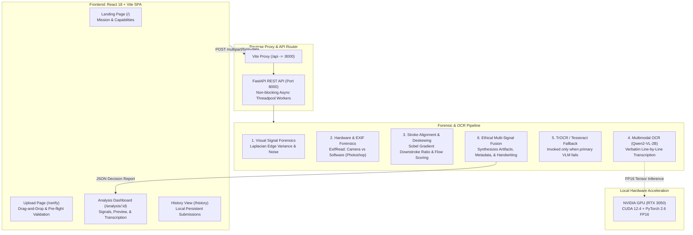

# EduVerify AI — Academic Integrity & Handwriting Forensics Platform
## Comprehensive Architecture, Implementation & Research Dossier
*Prepared for Architecture Review, Technical Evaluation, and Strategic Research on Perplexity AI*

---

## 1. Executive Summary & Purpose

### 1.1 The Core Problem
With the proliferation of multimodal generative AI and handwriting synthesis tools (e.g., GANs, diffusion-based pen-plotter generators, digital handwriting fonts), academic institutions and educators face a critical integrity challenge. Students can convert synthetic essays or LLM-generated code into realistic digital or printed handwriting. Conversely, over-reliance on opaque "AI detector" scores leads to devastating false-positive accusations against honest students with neurodiverse handwriting, non-native handwriting habits, or low-quality phone cameras.

### 1.2 Purpose of EduVerify AI
**EduVerify AI** is an explainable, multimodal forensic analysis platform specifically engineered for academic institutions and educators. Rather than functioning as an "automated accuser" or black-box detector, EduVerify AI serves as an **Educator Decision-Support System**:
1. It ingests images of handwritten assignments, exam scripts, lab reports, and notebook pages.
2. It decomposes the submission into multi-signal optical, sensor, and provenance forensics.
3. It transcribes handwritten notes line-by-line verbatim using multimodal vision-language models.
4. It synthesizes all signals into an ethical, human-interpretable verdict (`Likely Genuine`, `Uncertain`, or `Concern`) with concrete pedagogical next steps (e.g., student dialogue, physical paper inspection).

---

## 2. Core Ethical Philosophy & Constraints

> [!IMPORTANT]
> **Zero Automated Penalization Policy**  
> EduVerify AI **never** declares academic misconduct based purely on a machine learning probability score. Automated detectors suffer from severe domain shifts across paper textures, lighting conditions, and camera lenses. The platform enforces an ethical decision-support boundary: automated scores inform, but never replace, human pedagogical discretion.

---

## 3. High-Level System Architecture

The project employs a decoupled client-server architecture with hardware-accelerated local AI inference:

---

## 4. Detailed Component Implementation

### 4.1 Frontend Technology Stack (`Deepfake/eduverify-ai/src`)
* **Framework**: React 18 with Vite 5.
* **Routing**: React Router DOM v6 (`/`, `/verify`, `/analysis/:id`, `/history`).
* **Design & Styling**: Modular, custom CSS (`DashboardPage.css`, `UploadPage.css`, `LandingPage.css`) avoiding bulky UI framework bloat.
* **Iconography & Animation**: Lucide React icons with Framer Motion transitions.
* **Key User Experience Highlights**:
  * **File Ingestion**: Pre-flight validation for JPEG, PNG, and WEBP formats up to high-resolution camera sizes.
  * **Interactive Document Preview**: Displays the submitted document in the **exact upright orientation** determined by the orientation engine (`oriented_image_base64`).
  * **Extracted Text Panel**: Verbatim transcription rendered line-by-line with dynamic confidence metrics.
  * **Forensic Breakdown Cards**: Dedicated visual meters for AI Artifacts, Camera Sensor Metadata, C2PA Content Credentials, and Pedagogical Recommendations.
  * **Local Persistence**: Full analysis history stored in browser `localStorage`.

---

### 4.2 Backend Technology Stack (`Deepfake/eduverify-ai/backend`)
* **Language & Framework**: Python 3.10–3.14 with FastAPI and Uvicorn.
* **Concurrency**: Threadpool offloading (`starlette.concurrency.run_in_threadpool`) prevents the FastAPI event loop from blocking during PyTorch CUDA tensor execution.
* **API Endpoints**:
  * `GET /health`: Server health check.
  * `POST /api/v1/analyze`: Accepts multipart image upload, executes the 6-stage pipeline, and returns the full JSON forensic decision report.

---

### 4.3 Deep Forensic Modules Implemented

#### Module 1: Visual Artifact Forensics (`backend/api/services/vision.py`)
* **Algorithm**: Computes Laplacian edge variance ($\sigma^2_{\text{Laplacian}}$) over the grayscale luminance plane.
* **Physics Principle**: Physical pen-on-paper camera photographs exhibit high-frequency sensor noise and microscopic paper fiber texture ($\sigma^2 > 100$). Synthetically generated images (diffusion models, AI handwriting renders) often exhibit telltale unphysical smoothing, loss of sensor grain, or uniform pixel blurring ($\sigma^2 < 50$).

#### Module 2: Metadata & Provenance Forensics (`backend/api/services/metadata.py`)
* **Algorithm**: Parses EXIF metadata headers via `exifread`.
* **Detection Vectors**:
  * **Authentic Hardware**: Camera Make/Model (e.g., Apple iPhone, Samsung Galaxy, Sony) indicates a direct physical capture.
  * **Digital Manipulation**: Software tags containing signatures such as `Adobe Photoshop`, `Canva`, `GIMP`, or `Procreate` flag image manipulation.
  * **Provenance**: Flags absence of cryptographic C2PA (Coalition for Content Provenance and Authenticity) manifests.

#### Module 3: Novel Stroke-Level Orientation & Deskewing (`backend/api/services/orientation.py`)
* **Problem Solved**: Students frequently photograph notebook pages at odd angles, sideways ($90^\circ, 270^\circ$), or upside-down ($180^\circ$). Standard OCR engines either crash, output gibberish, or transcribe the page backwards from bottom to top.
* **Mathematical Solution**:
  1. **Individual Letter Stroke Gradient Analysis** (`detect_stroke_is_sideways`):
     * Computes Sobel spatial derivatives ($G_x = \frac{\partial I}{\partial x}$, $G_y = \frac{\partial I}{\partial y}$).
     * Normal Latin handwriting is dominated by vertical downstrokes (stems of letters `t, l, b, d, h, p`), generating strong horizontal gradients ($G_x \gg G_y$, normal angles $< 30^\circ$).
     * When rotated sideways ($90^\circ/270^\circ$), downstrokes become horizontal ($G_y \gg G_x$, normal angles $> 60^\circ$).
     * If ratio $\frac{\text{mean}(\theta < 30^\circ)}{\text{mean}(\theta > 60^\circ)} < 0.90$, the document is mathematically isolated as sideways.
  2. **Reading Flow Scoring** (`score_reading_flow`):
     * Distinguishes upright ($0^\circ$) from inverted ($180^\circ$) documents.
     * Rewards top-of-page signals (Title, Chapter, Definition, "When you...") with $+10$ to $+15$ points.
     * Penalizes bottom-first signals (trailing conjunctions "and", "or", "it produces", footer metadata "Page: 8", "Date:") with $-10$ to $-20$ points.
     * Ranks candidates via $\text{Rank} = \text{word\_count} + 2 \times \text{flow\_score}$.
  3. **Fine Deskewing** (`apply_fine_deskew`):
     * Applies minimum-area bounding box contours to correct paper slant between $-20^\circ$ and $+20^\circ$.

#### Module 4: Multimodal Vision-Language OCR (`backend/api/services/ocr.py`)
* **Primary Engine**: **`Qwen/Qwen2-VL-2B-Instruct`** running in PyTorch FP16 on CUDA.
* **Verbatim Transcription**: Uses assistant token prefilling (`<|im_start|>assistant\nText:\n`) to eliminate conversational LLM preamble ("Here is the text:") and force strictly literal character-by-character transcription.
* **Strict Fidelity**: Preserves original student abbreviations, spelling errors, and formulas without conversational autocorrection.
* **Synchronized Base64 Output**: Emits `oriented_image_base64` so the UI preview is guaranteed to match the transcribed reading direction.

#### Module 5: TrOCR & Tesseract Fallback (`backend/api/services/handwriting.py`)
* **Fallback Strategy**: If Qwen2-VL is unavailable or encounters GPU out-of-memory errors, the system gracefully falls back to `microsoft/trocr-base-handwritten` or Tesseract OCR with adaptive Gaussian thresholding.

#### Module 6: Ethical Multi-Signal Fusion Engine (`backend/api/services/fusion.py`)
* **Synthesis Rules**:
  * **Likely Genuine** ($\approx 85\text{--}95\%$ confidence): Authentic camera EXIF, natural sensor noise ($\sigma^2 > 100$), legible handwriting extracted.
  * **Concern**: Photo-editing software detected (Photoshop/Canva) OR synthetic smoothing score $\ge 65\%$.
  * **Uncertain**: Stripped metadata (WhatsApp/web upload) with ambiguous stroke variance; flags for human pedagogical dialogue.

---

## 5. Development & DevOps Tooling Implemented

1. **Dual Launcher Batch Scripts**:
   * `run_project.bat`: Single double-click launcher that detects Python GPU environments (`venv_gpu` vs `venv`), launches the FastAPI backend on port 8000, and launches Vite frontend on port 5173.
   * `stop_project.bat`: Cleanly terminates processes on ports 8000 and 5173.
2. **Comprehensive `.gitignore`**:
   * Excludes Python virtual environments (`venv_gpu/`, `.venv/`), Python bytecode (`__pycache__/`), Node dependencies (`node_modules/`), Vite build artifacts (`dist/`), and large Hugging Face model weights (`*.safetensors`, `*.bin`).

---

## 6. What Has Been Completed vs. What Needs Next Steps

### Completed Milestone Checklist
- [x] Full-stack architecture (React 18 + FastAPI).
- [x] Visual artifact frequency analysis (Laplacian noise distribution).
- [x] EXIF hardware sensor vs. digital editing software detection.
- [x] Sobel gradient letter-stroke orientation detection ($0^\circ, 90^\circ, 180^\circ, 270^\circ$).
- [x] Reading flow evaluation to prevent bottom-to-top backwards transcription on inverted pages.
- [x] Verbatim multimodal handwriting transcription via Qwen2-VL-2B (PyTorch CUDA FP16).
- [x] Fallback pipeline (TrOCR / Tesseract).
- [x] Multi-signal ethical fusion decision engine.
- [x] Synchronized upright image rendering in user dashboard.
- [x] One-click automated launcher and production-grade `.gitignore`.

---

## 7. Strategic Research Questions for Perplexity AI

*When uploading this document to Perplexity, use the following prompts to research cutting-edge advancements and next steps:*

### Prompt 1: Vision-Language Model Verification & Self-Correction
> *"Based on the attached EduVerify AI architecture dossier, evaluate the optimal architecture for a Two-Pass Visual Verification loop. How can a Vision-Language Model (Qwen2-VL-2B) cross-examine its own initial draft against document stroke projection profiles to detect skipped lines, recover substituted words, and suppress hallucinated sentences without doubling inference latency?"*

### Prompt 2: Advanced Forensic Handwriting Synthesis Detection
> *"Review the forensic feature extraction in EduVerify AI (currently using Laplacian edge variance and EXIF metadata). What state-of-the-art frequency-domain methods (e.g., 2D Discrete Cosine Transform (DCT) peak anomaly detection, Spec-ResNet, or pen-pressure pressure gradient variance) can be integrated to detect modern diffusion-based handwriting synthesizers (like Calligrapher or pen-plotter SVG engines)?"*

### Prompt 3: Production Deployment & Cost Optimization
> *"Analyze the deployment dilemma in Section 4.3 and 5. What is the most cost-effective architecture to host EduVerify AI in production? Compare: (A) Serverless GPU (Modal Labs / RunPod) vs. (B) Dedicated T4 GPU container (Hugging Face Spaces) vs. (C) Decoupled API architecture (FastAPI on CPU cloud calling external Vision APIs like Groq or Gemini Flash)."*

### Prompt 4: C2PA Content Credentials Integration
> *"How can EduVerify AI implement real-time validation of C2PA (Coalition for Content Provenance and Authenticity) manifests in Python to cryptographically prove if an image was captured by an authentic mobile phone sensor vs. exported from generative tools like DALL-E or Midjourney?"*

---
*End of Dossier. Ready for upload to Perplexity AI.*
